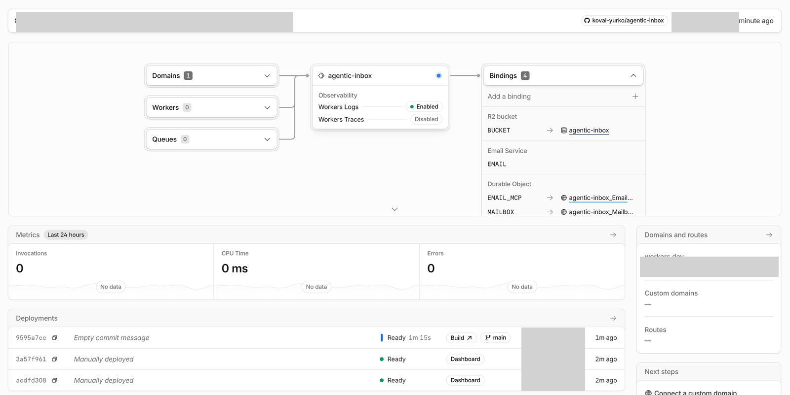
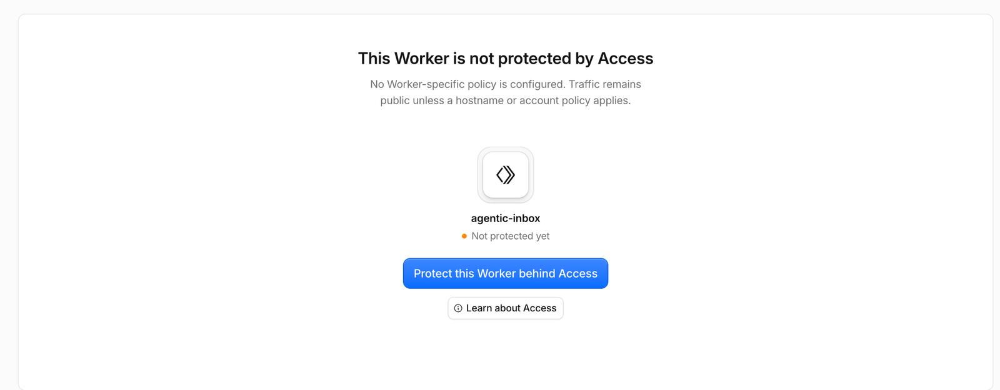
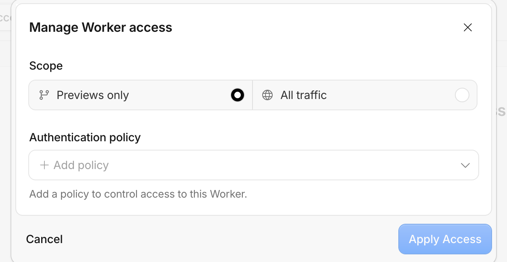
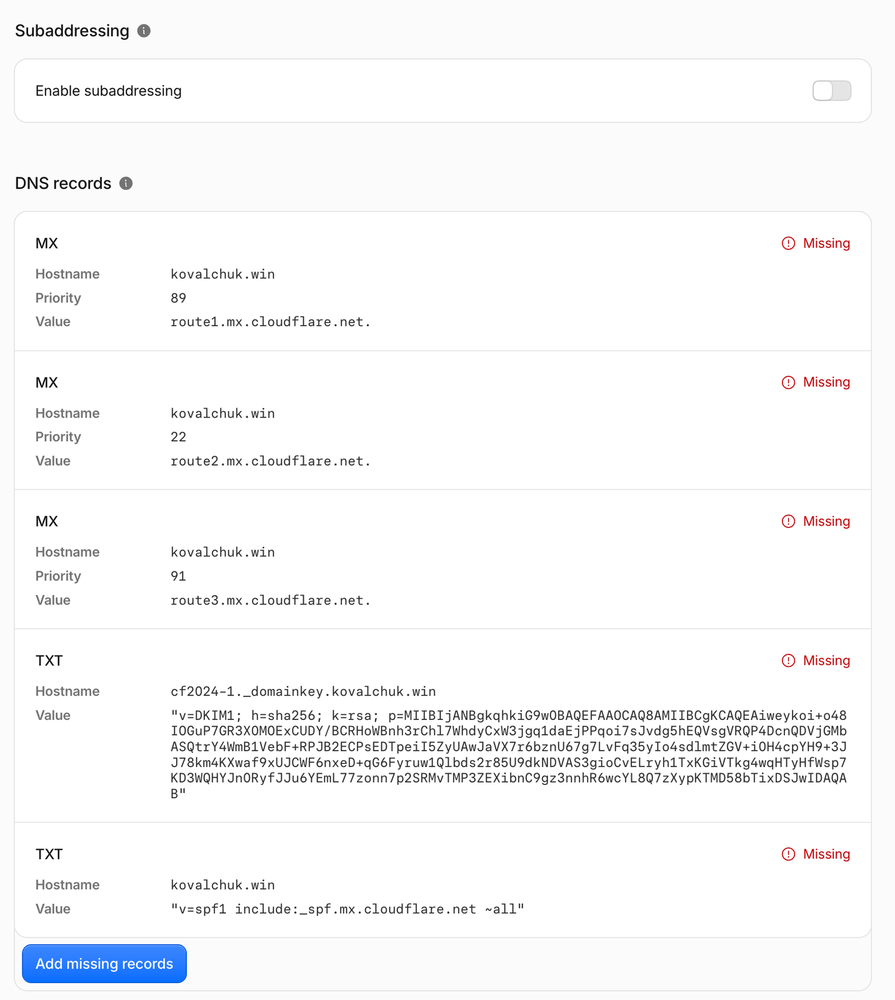
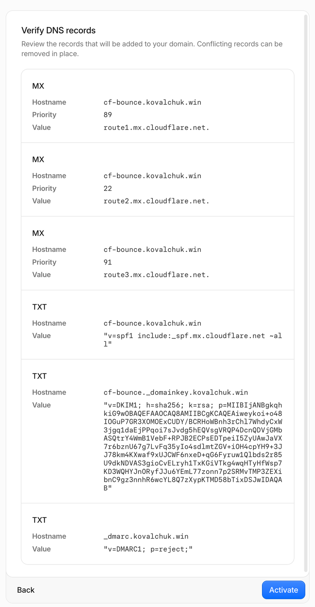
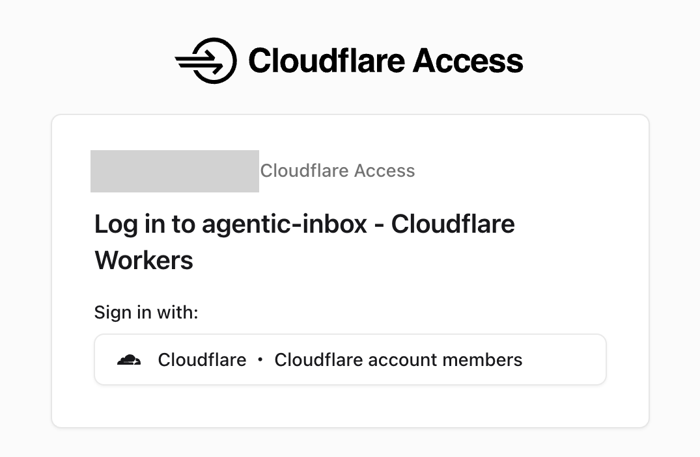
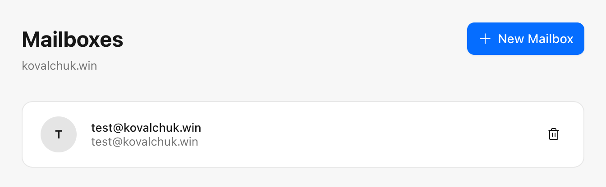
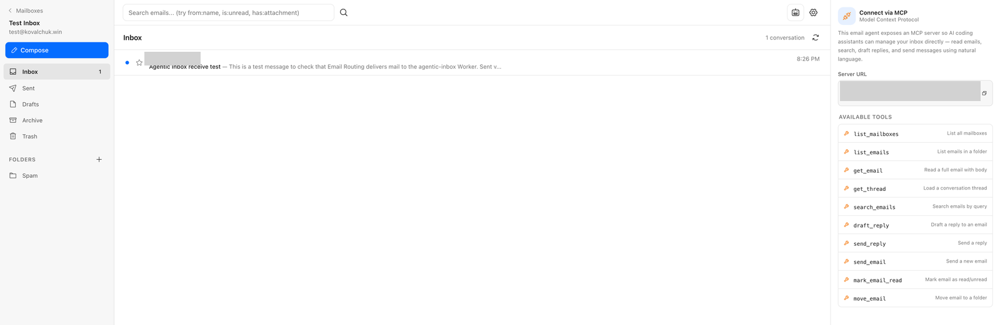

# Setup guide

This guide shows how to deploy Agentic Inbox to your Cloudflare account, step by step.
The screenshots come from a real setup of this fork with the domain `kovalchuk.win` and the app URL `inbox.kovalchuk.win`.
Replace these values with your own domain.

## Index

- [What you need](#what-you-need)
- [Step 1: Set the domain in wrangler.jsonc](#step-1-set-the-domain-in-wranglerjsonc)
- [Step 2: Create the Worker from your repository](#step-2-create-the-worker-from-your-repository)
- [Step 3: Check the deploy](#step-3-check-the-deploy)
- [Step 4: Turn on Cloudflare Access](#step-4-turn-on-cloudflare-access)
- [Step 5: Add the Access secrets](#step-5-add-the-access-secrets)
- [Step 6: Receive email with Email Routing](#step-6-receive-email-with-email-routing)
- [Step 7: Send email with Email Sending](#step-7-send-email-with-email-sending)
- [Step 8: Check the custom domain](#step-8-check-the-custom-domain)
- [Step 9: Test the app](#step-9-test-the-app)
- [Step 10: Connect an MCP client](#step-10-connect-an-mcp-client)
  - [10.1 Create a service token](#101-create-a-service-token)
  - [10.2 Allow the token in the Access application](#102-allow-the-token-in-the-access-application)
  - [10.3 Add the server to your MCP client](#103-add-the-server-to-your-mcp-client)
  - [10.4 Test the connection](#104-test-the-connection)
- [Logs](#logs)
- [Troubleshooting](#troubleshooting)

## What you need

- A Cloudflare account.
- A domain that uses Cloudflare DNS (a zone in your account). In this guide, the domain is `yourdomain.com`.
- A GitHub fork of this repository.

## Step 1: Set the domain in `wrangler.jsonc`

Edit `wrangler.jsonc` in your fork, and push the change to `main`.

```jsonc
"workers_dev": false,
"routes": [
    { "pattern": "inbox.yourdomain.com", "custom_domain": true }
],
"vars": {
    "DOMAINS": "yourdomain.com",
    "EMAIL_ADDRESSES": []
},
```

- `DOMAINS` is the domain that receives email. The app accepts mail for any address on it, for example `hello@yourdomain.com`.
- `routes` attaches the custom domain `inbox.yourdomain.com` to the Worker on each deploy.
- `workers_dev: false` turns off the public `*.workers.dev` URL.

> **Important:** Set `DOMAINS` in `wrangler.jsonc`, not only in the dashboard. Each deploy replaces dashboard variables with the values from `wrangler.jsonc`. Secrets are not replaced.

## Step 2: Create the Worker from your repository

1. In the dashboard, open **Workers & Pages** and click **Create application**.
2. Select **Continue with GitHub**, and then select your fork.
3. Set **Build command** to `npm run build` and **Deploy command** to `npx wrangler deploy`.
4. Click **Deploy**.


Or click this button. It copies this repository to your GitHub account and creates the Worker:

[](https://deploy.workers.cloudflare.com/?url=https://github.com/koval-yurko/agentic-inbox)

If your repository is not in the list, the Cloudflare GitHub app has no access to it.
On GitHub, open **Settings → Applications → Installed GitHub Apps → Cloudflare Workers and Pages**, and give it access to the repository.

## Step 3: Check the deploy

The first deploy creates the R2 bucket and the Durable Objects.
Open the Worker **Overview** tab. The **Bindings** box shows `BUCKET`, `EMAIL`, `EMAIL_MCP` and `MAILBOX`.



Open **Settings → Builds**. Make sure that the Git repository is your fork and the production branch is `main`.
After this step, each push to `main` starts a new build and deploy.


**Settings → Variables and secrets** shows the variables from `wrangler.jsonc` and the bindings.


## Step 4: Turn on Cloudflare Access

The app does not start in production without Cloudflare Access. It returns an error until you do this step.

1. Open the Worker **Access** tab, and click **Protect this Worker behind Access**.

   

2. In **Scope**, select **All traffic**. The default value, **Previews only**, does not protect production.
3. In **Authentication policy**, add a policy. For example, select **Cloudflare account members**.
4. Click **Apply Access**.

   

5. The next dialog shows 2 values: `POLICY_AUD` and `TEAM_DOMAIN`. Copy them.

## Step 5: Add the Access secrets

1. Open **Settings → Variables and secrets**, and click **Add variable**.
2. Add `POLICY_AUD` and `TEAM_DOMAIN` with the values from Step 4.
3. Select **Secret** for each value.
4. Click **Add 2 variables and deploy**.


`TEAM_DOMAIN` can be the team URL (`https://<team>.cloudflareaccess.com`) or the full `.../cdn-cgi/access/certs` URL.

## Step 6: Receive email with Email Routing

1. Open your domain, and then open **Email → Email Routing**. Turn on Email Routing.
2. Open the **Settings** tab. If the DNS records show **Missing**, click **Add missing records**.

   

3. Open the **Routing rules** tab. Edit the **Catch-all** rule:
   - Set **Action** to **Send to a Worker**.
   - Set **Destination** to your Worker (`agentic-inbox`).
4. Make sure that the rule status is **Active**.

   

## Step 7: Send email with Email Sending

The Worker sends email through the `EMAIL` binding. The domain must be onboarded to Email Sending.

1. Open **Compute → Email Service → Email Sending**, and click **Onboard Domain**.
2. Select your domain, and click **Continue**.
3. Review the DNS records, and click **Activate**.

   

4. Wait until **Sending status** is **Enabled** and **DNS records** is **Configured**.

   

## Step 8: Check the custom domain

Open the Worker **Domains** tab. The custom domain from `wrangler.jsonc` shows with the type **Production**.
The **Worker URL** switches are off, because `workers_dev` is `false`.


A custom domain is not a Worker route. It does not show on the zone **Workers Routes** page.
It shows here, and in the zone DNS records as a read-only record of type **Worker**.

## Step 9: Test the app

1. Open `https://inbox.yourdomain.com`. Cloudflare Access asks you to log in.

   

2. After you log in, click **New Mailbox**, and create a mailbox, for example `test@yourdomain.com`.

   

3. Send an email to the new address from an external mailbox. The email shows in **Inbox**.
4. Click **Compose**, and send an email to an external address. Make sure that it arrives.



The panel on the right shows the MCP server URL (`https://inbox.yourdomain.com/mcp`) and the available tools.
The `/mcp` endpoint is also behind Access. An external MCP client needs an Access service token. See [Step 10](#step-10-connect-an-mcp-client).

> **Note:** Some screenshots hide account names and `workers.dev` URLs with grey boxes.

## Step 10: Connect an MCP client

The MCP server is at `https://inbox.yourdomain.com/mcp`. It uses the Streamable HTTP transport.
Cloudflare Access protects it. An MCP client cannot do the browser login, so it must send an Access **service token** with each request.
Access then adds a signed JWT to the request, and the Worker accepts it.

> **Warning:** A token holder can read and send email from **all** mailboxes. The app has no access control for each mailbox. Give the token a short duration, and revoke it if it leaks.

### 10.1 Create a service token

1. Open **Zero Trust → Access → Service credentials → Service Tokens**, and click **Create Service Token**.
2. Enter a name, for example `agentic-inbox-mcp`, and select a duration.
3. Copy the **Client ID** and the **Client Secret**.

> **Warning:** Cloudflare shows the Client Secret only 1 time. Keep it in a password manager. Do not put it in the repository.

### 10.2 Allow the token in the Access application

1. Open **Zero Trust → Access → Applications**. Find the application that Step 4 created. Its name is similar to `agentic-inbox - Cloudflare Workers`.
2. Add a policy:
   - **Action:** `Service Auth`. Do not use `Allow`, because `Allow` sends the client to the login page.
   - **Include:** `Service Token` → `agentic-inbox-mcp`.
3. Save the policy. Keep the current login policy, so that the browser login continues to work.

### 10.3 Add the server to your MCP client

**Claude Code:**

```bash
claude mcp add --transport http agentic-inbox https://inbox.yourdomain.com/mcp \
  --header "CF-Access-Client-Id: <client-id>" \
  --header "CF-Access-Client-Secret: <client-secret>"
```

**Cursor** (`~/.cursor/mcp.json`) and other clients that accept a URL with headers:

```json
{
  "mcpServers": {
    "agentic-inbox": {
      "url": "https://inbox.yourdomain.com/mcp",
      "headers": {
        "CF-Access-Client-Id": "<client-id>",
        "CF-Access-Client-Secret": "<client-secret>"
      }
    }
  }
}
```

### 10.4 Test the connection

```bash
curl -i -X POST https://inbox.yourdomain.com/mcp \
  -H "CF-Access-Client-Id: <client-id>" \
  -H "CF-Access-Client-Secret: <client-secret>" \
  -H "Content-Type: application/json" \
  -H "Accept: application/json, text/event-stream" \
  -d '{"jsonrpc":"2.0","id":1,"method":"initialize","params":{"protocolVersion":"2025-03-26","capabilities":{},"clientInfo":{"name":"curl","version":"1"}}}'
```

A good result is HTTP `200` with an MCP response.
In the MCP client, call `list_mailboxes` first. The other tools need a `mailboxId`, for example `test@yourdomain.com`.

For local development, `npm run dev` does not use Access. A local client can use `http://localhost:<port>/mcp` with no headers.

## Logs

- Open the Worker **Observability** tab to see the logs in the dashboard.
- Or run `npx wrangler tail agentic-inbox` to see live logs in a terminal.

## Troubleshooting

| Problem | Cause and fix |
|---|---|
| `Cloudflare Access must be configured in production` | `POLICY_AUD` or `TEAM_DOMAIN` is not set. Do Step 4 and Step 5. |
| `Invalid or expired Access token` | The secrets are wrong. Turn Access off and on again, and set the new values. |
| A push to `main` does not start a build | The Cloudflare GitHub app has no access to the repository. See Step 2. |
| An email does not arrive | Check that the catch-all rule is **Active** (Step 6). Check that the mailbox exists in the app. The Worker ignores mail for addresses without a mailbox. |
| A dashboard variable changes back after a deploy | Set the value in `wrangler.jsonc` (Step 1). |
| The MCP client gets `302` to a login page | The Access policy for the token must use the action `Service Auth` (Step 10.2). |
| The MCP client gets `403 Invalid or expired Access token` | Add the token to the same Access application as the Worker (Step 10.2). |
| The MCP client gets `403 Missing required CF Access JWT` | The client does not send the `CF-Access-Client-Id` and `CF-Access-Client-Secret` headers (Step 10.3). |
